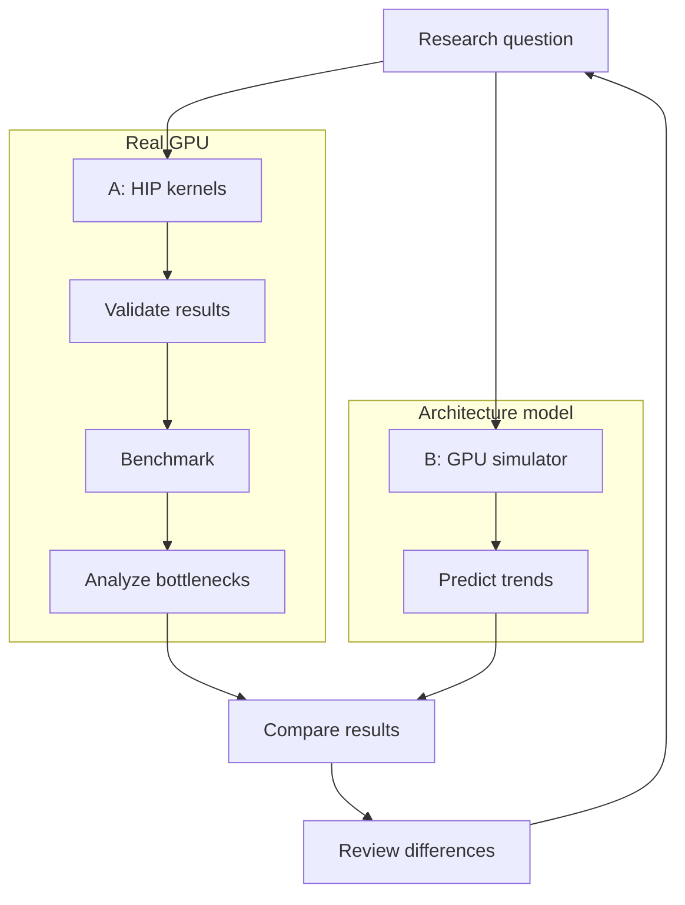
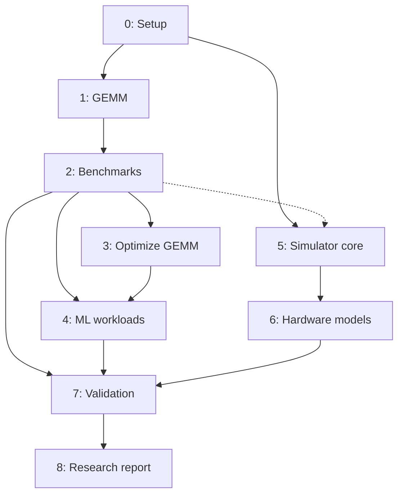

# AEGIS Development Roadmap

> **Status:** Planning baseline · **Owner:** Independent project · **Revision:** 1 · **Last updated:** 2026-11-07

AEGIS (AI Execution & GPU Investigation Simulator) links **Component A: measured performance of real C++/AMD HIP ML kernels** to **Component B: a simplified C++ GPU architecture simulator**. The objective is to explain observed performance, test architectural hypotheses, and compare simulator predictions with measured trends.

This document is a living plan, not a claim that any phase has been completed. All estimates are **active engineering hours** and include learning, implementation, debugging, tests, and documentation. They are not guarantees or deadlines.

## System overview

**Interpretation:** The simulator is an intentionally simplified model, not a proprietary AMD GPU replica. Benchmark observations should inform hypotheses and calibration, but tuning must not be mistaken for independent validation.

## Roadmap at a glance

| Phase | Focus | Hours | Depends on |
| --- | --- | ---: | --- |
| 0 | Project foundation | 8–12 | — |
| 1 | Baseline GEMM correctness | 15–25 | 0 |
| 2 | Benchmarking and measurements | 20–30 | 1 |
| 3 | GEMM optimization and diagnosis | 30–45 | 2 |
| 4 | Broader ML workloads | 35–55 | 2–3 |
| 5 | Simulator foundations | 35–55 | 0; informed by 2 |
| 6 | Scheduling, occupancy, memory models | 45–70 | 5 |
| 7 | Model/measurement validation | 30–50 | 2, 4, 6 |
| 8 | Architecture experiments and research report | 20–35 | 7 |
| **Total** | | **238–377** | |

## Phase dependencies

The arrows indicate **prerequisites or useful information flow**, not necessarily a strictly sequential calendar. Phase 5 can begin before Phase 4 if the interfaces and modeling assumptions are documented.

## Phase 0 — Project foundation (8–12 hours)

**Objective:** Establish a reproducible development environment and a documentation-first workflow.

**Deliverables:** GitHub repository; README and this roadmap; initial directory plan; environment/setup notes; Git ignore rules; build/toolchain check for C++, CMake, AMD HIP/ROCm, and RX 7800 XT; issue/milestone tracking convention.

**Acceptance criteria:** Another developer can follow documented setup steps, reproduce toolchain checks, and understand the scope and phase status. Actual GPU support must be verified rather than assumed.

**Risks/decisions:** ROCm/HIP support on the installed OS and specific GPU; build system and testing framework; license selection.

## Phase 1 — Correct baseline GEMM (15–25 hours)

**Objective:** Implement a clear, correctness-first GPU matrix multiplication baseline.

**Deliverables:** CPU reference; C++/HIP GEMM kernel; tests across square, rectangular, non-multiple-of-tile, and small matrices; error tolerance policy; documented launch/indexing design.

**Starting design hypothesis:** One GPU thread per output element, 2D organization, 16×16 threads per workgroup, row-major indexing. This is a baseline choice subject to measured revision.

**Acceptance criteria:** Tests pass against reference results across the declared test suite; bounds are handled safely; instructions for building and running are reproducible. Performance is not yet an optimization criterion.

## Phase 2 — Benchmark infrastructure (20–30 hours)

**Objective:** Produce credible, repeatable GPU timing and throughput measurements.

**Deliverables:** Warmup and repeated-run harness; GPU-event timing with explicit synchronization where needed; configuration and environment metadata; raw results; GEMM throughput and arithmetic-intensity calculations; initial bottleneck hypotheses.

**Acceptance criteria:** Results can be rerun with recorded inputs, environment, units, and methodology; host launch overhead is not confused with GPU execution time; measurement variability is reported. Claims distinguish observed data from theoretical ceilings.

## Phase 3 — GEMM performance investigations (30–45 hours)

**Objective:** Explain and improve GEMM performance using controlled experiments.

**Deliverables:** At least two controlled kernel variants (for example, baseline vs tiled/LDS); comparison across matrix sizes; hypotheses on memory reuse, occupancy, synchronization, and arithmetic intensity; plots and an investigation report.

**Acceptance criteria:** Every reported speedup has a defined baseline, identical correctness requirements, repeated measurements, and an explanation of tradeoffs. Unsupported bottleneck claims are explicitly marked as hypotheses.

## Phase 4 — Broader ML workload suite (35–55 hours)

**Objective:** Determine whether conclusions generalize beyond GEMM.

**Deliverables:** Selected operations such as reductions, softmax, activations, or normalization; CPU/reference checks; standardized benchmark inputs; cross-workload analysis of compute- and memory-sensitive behavior.

**Acceptance criteria:** At least three distinct workload families have validated implementations and comparable benchmark reports. The final selection is an engineering decision, not a requirement to implement every possible ML operation.

## Phase 5 — Simulator foundations (35–55 hours)

**Objective:** Create a testable C++ simulation framework with explicit abstraction boundaries.

**Deliverables:** Simulator scope/specification; configuration schema; workload representation; event/cycle progression model; deterministic test fixtures; basic execution and reporting; list of modeled vs omitted features.

**Acceptance criteria:** Small synthetic workloads produce predictable, unit-tested behavior; assumptions and units are documented. No claim of hardware fidelity is made without evidence.

## Phase 6 — Execution and memory models (45–70 hours)

**Objective:** Model mechanisms likely to affect observed GPU performance.

**Deliverables:** Simplified compute-unit resources; wavefront/workgroup scheduling; register and occupancy limits; arithmetic throughput; configurable memory latency/bandwidth; tests and parameter sensitivity experiments.

**Acceptance criteria:** Tests demonstrate expected qualitative behavior under resource constraints; modeled bottlenecks can be traced to explicit parameters and rules; simplifying assumptions remain visible.

## Phase 7 — Simulator validation (30–50 hours)

**Objective:** Compare predicted and measured performance without hiding model error.

**Deliverables:** Mapping from benchmark cases to simulator inputs; held-out comparison cases where feasible; plots of predicted vs observed trends; error metrics; documented mismatches and model limitations.

**Acceptance criteria:** Reproducible comparisons exist across multiple workload shapes/families; the report identifies where the simulator succeeds, fails, and cannot make a defensible prediction. Calibration cases are distinguished from evaluation cases.

## Phase 8 — Architectural experiments and report (20–35 hours)

**Objective:** Use the validated model to reason about hypothetical GPU design choices.

**Deliverables:** Controlled parameter sweeps (e.g., bandwidth, execution resources, register capacity); at least two research questions; final technical report with methodology, results, limitations, and future work; polished project index.

**Acceptance criteria:** Every conclusion links to reproducible experiments, distinguishes simulation from physical measurements, and explains why its assumptions are plausible.

## Scheduling scenarios

Hours are **ranges**, not precise forecasts. Divide total estimated hours by available weekly hours for an approximate active-work duration:

| Weekly commitment | Approximate duration |
| --- | --- |
| 5 h/week | 48–76 weeks |
| 10 h/week | 24–38 weeks |
| 15 h/week | 16–26 weeks |
| 20 h/week | 12–19 weeks |

Suggested initial milestone: **Phases 0–3 (73–112 hours)**. At 10 hours/week, plan roughly **8–12 weeks** of active work, with flexibility for tooling surprises and school commitments. Do not force later phases into fixed calendar dates until actual velocity is known.

## Progress tracking

For each phase, maintain:

1. **Issue(s) and milestone:** specific scope, estimated hours, dependencies, and definition of done.
2. **Decision record:** question, alternatives, assumptions, choice, and rationale.
3. **Experiment record:** hypothesis, hardware/software, configuration, correctness check, procedure, raw results, and interpretation.
4. **Review:** actual hours, deviations, unresolved questions, and next-phase readiness.

Suggested status values: **Not started → In progress → Validation → Complete**. Update the roadmap when evidence changes the plan; preserve rationale for major scope changes.

## Current next actions

- [ ] Verify local toolchain and HIP support on the intended GPU/OS.
- [ ] Agree on repository structure and build/test strategy.
- [ ] Add development setup and experiment methodology documentation.
- [ ] Create GitHub milestones/issues for Phase 0 and Phase 1.
- [ ] Start Phase 1 only after baseline environment checks pass.
